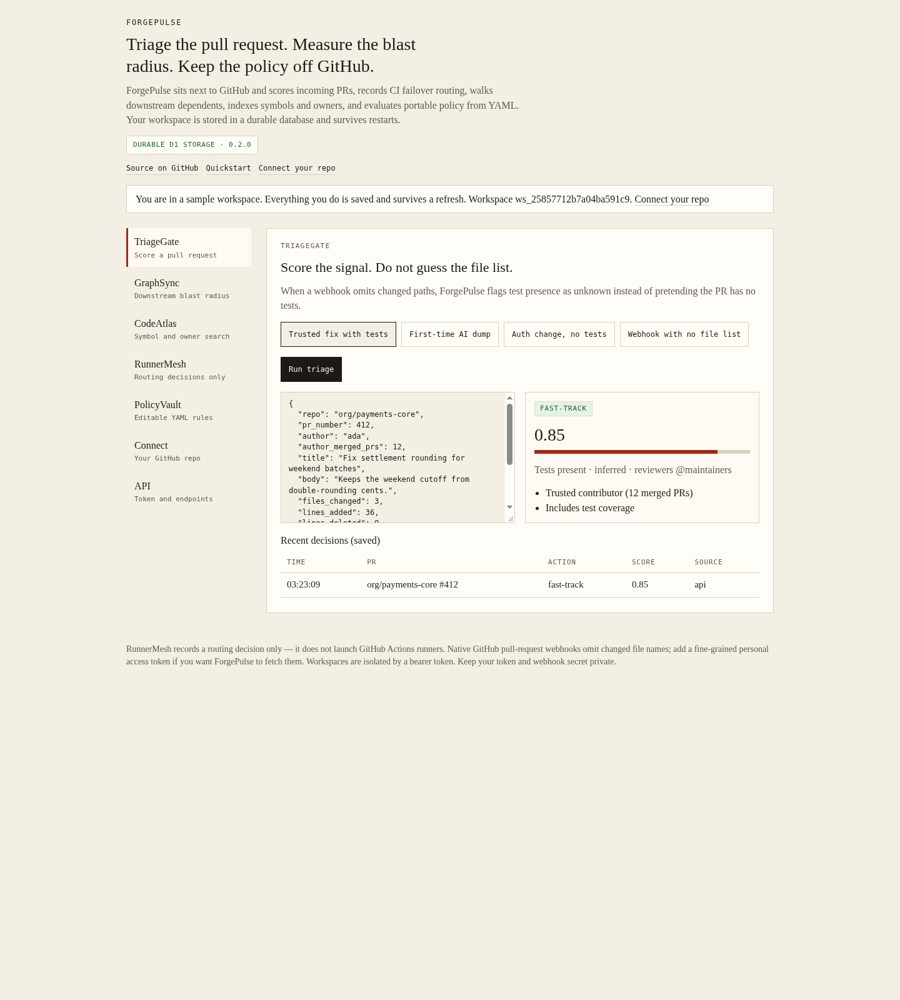
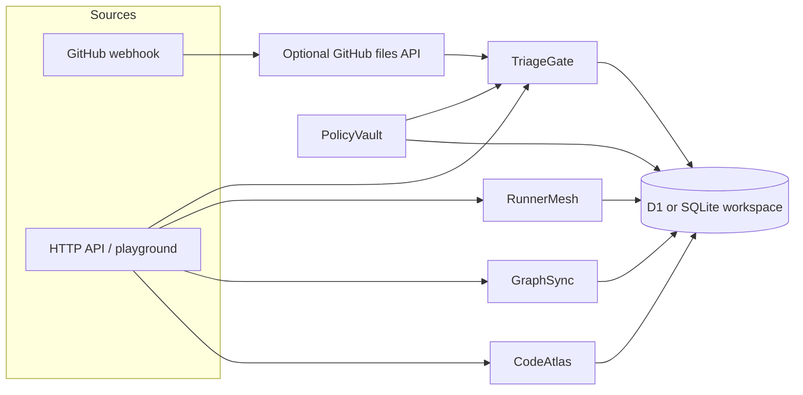

# ForgePulse

**Triage the pull request. Measure the blast radius. Keep the policy off GitHub.**

ForgePulse is a small HTTP service that sits next to GitHub and covers five gaps maintainers feel every week: noisy or AI-generated pull requests, CI queue pain, cross-repo blast radius, code navigation across ownership, and policy locked in GitHub's UI.

Live product (durable Cloudflare D1 workspaces, free Workers tier): [forgepulse.kfairley9999.workers.dev](https://forgepulse.kfairley9999.workers.dev)



A stranger can open the live site, land in a private sample workspace, and use every module immediately. Connecting a real GitHub repository takes a webhook and a secret — no GitHub App registration required today.

## What it does

| GitHub gap | Module | What you see |
| --- | --- | --- |
| AI-generated volume vs. maintainer trust | **TriageGate** | Scores a PR from contributor history, test presence, diff size, title quality, and AI signals. Actions: `fast-track`, `standard-review`, `quarantine-bot-check`, `block-policy`. History is saved per workspace. |
| CI queueing and hosted-runner incidents | **RunnerMesh** | Records a **routing decision** only: priority queue with a monotonic sequence and failover to a fallback pool when GitHub-hosted runners are marked degraded. It does **not** launch runners. |
| Monorepo and multi-repo coordination | **GraphSync** | Breadth-first walk of a repository dependency graph to compute downstream blast radius. The source repo is excluded. Cycles are ignored. Edges can be edited and persist. |
| Search, ownership, and historical PR context | **CodeAtlas** | Indexes symbols, file paths, code owners, and related PRs, and searches them. |
| Governance locked to GitHub UI settings | **PolicyVault** | Editable, validated YAML/JSON policy: protected paths, test thresholds, reviewers, and whether unverified AI PRs are allowed. |

## New here? Start in one minute

1. Open [https://forgepulse.kfairley9999.workers.dev](https://forgepulse.kfairley9999.workers.dev). The site creates a private **guest workspace**, seeds it with a fictional sample org (`org/payments-core` and friends), and stores the token only in your browser.
2. Stay on **TriageGate**. A sample pull request is scored automatically. Change the fields and click **Score this pull request** to see other actions (try a first-time author, a large diff, or a path under `auth/`).
3. Open **GraphSync**, **CodeAtlas**, **RunnerMesh**, and **PolicyVault**. Each module talks to your workspace and keeps results after a refresh. RunnerMesh is labeled honestly: routing decisions only.
4. When you want your own repository, open **Connect your repo** and follow the steps on that page (also written below).

Your guest workspace is isolated from everyone else. Creating a named workspace is optional and uses the same Connect flow.

## Connect your own GitHub repository

ForgePulse uses a **repository webhook plus a per-workspace secret**. A GitHub App would be nicer for org-wide install, but it has to be registered by the project owner first; that path is not available to a stranger today.

1. In the playground, open **Connect your repo**. Copy the **webhook URL** and the **webhook secret**. Keep the secret like a password.
2. In the GitHub repository (or organization) you want to connect: **Settings → Webhooks → Add webhook**.
   - Payload URL: the webhook URL you copied (`https://forgepulse.kfairley9999.workers.dev/w/<workspace-id>/webhooks/github`)
   - Content type: `application/json`
   - Secret: the webhook secret
   - SSL verification: enabled
   - Events: choose **Let me select individual events**, then enable **Pull requests**
   - Active: checked, then **Add webhook**
3. GitHub sends a `ping` event. ForgePulse records it as ignored (only `pull_request` is triaged). A green check on the webhook is enough.
4. Optional, but recommended: paste a **fine-grained personal access token** on the Connect page with read access to **Pull requests** (and metadata) for that repository. Native GitHub `pull_request` webhooks do **not** include changed file names. When a token is saved, ForgePulse calls `GET /repos/{repo}/pulls/{n}/files` and the search API for merged-PR counts so test inference and protected-path checks work. The token is encrypted at rest and never shown again. A fine-grained PAT you can revoke is enough; do not use a classic token with broad scope if you can avoid it.
5. Open a pull request, or click **Redeliver** on a `pull_request` delivery. The decision appears under **TriageGate** history and in the Connect event log.

Rotate the webhook secret from the Connect page if it leaks; then update the secret on GitHub to match.

## Architecture



A native GitHub `pull_request` webhook does not include changed file names. When a GitHub token is configured, ForgePulse fetches the file list. When it is not, and the payload has no `files` or `commits` paths, test presence is flagged **unknown** — the service does not pretend the PR has no tests.

State lives in **Cloudflare D1** on the live Worker, and in **SQLite** for the local Python server and Docker image. Each workspace has its own policy, graph, symbol index, CI queue, and event history. Access tokens are stored as HMAC hashes; webhook secrets and GitHub tokens are wrapped with AES-GCM under `FORGEPULSE_MASTER_KEY`.

## Quickstart (local)

Python 3.10 or newer. The package is **not** published to PyPI.

```bash
python -m pip install -e ".[dev]"
python -m forgepulse
```

The playground is at [http://127.0.0.1:8080/](http://127.0.0.1:8080/). The first start writes `.data/forgepulse.sqlite` and `.data/master.key` (mode `0600` when the OS allows it).

```bash
python -m ruff check src tests
python -m ruff format src tests
python -m mypy --strict src
python -m pytest --cov=forgepulse --cov-fail-under=90
```

Set `FORGEPULSE_LIVE_SMOKE=1` to include GET-only checks against the deployed Worker. CI runs those GET checks on pushes to `main`.

Docker:

```bash
docker build -t forgepulse .
docker run --rm -p 8080:8080 -v forgepulse-data:/app/.data forgepulse
```

## API reference

All mutating routes and workspace reads require a bearer token from `POST /workspaces` or `POST /workspaces/guest`. Send `Authorization: Bearer <token>` or `X-ForgePulse-Token: <token>`. Webhooks authenticate with `X-Hub-Signature-256` instead.

| Method | Path | Auth | Purpose |
| --- | --- | --- | --- |
| `GET` | `/` | no | Playground UI |
| `GET` | `/healthz` | no | `status`, `version`, `mode` (`durable`), `storage` (`d1` or `sqlite`) |
| `POST` | `/workspaces` | no (rate-limited) | Named user workspace. Body: `{ "name": "My workspace" }`. Returns `token` and `webhook_secret` once. |
| `POST` | `/workspaces/guest` | no (rate-limited) | Sample workspace, pre-seeded. Same return shape. |
| `GET` | `/workspace` | yes | Public workspace metadata, webhook URL, whether a GitHub token is configured |
| `PATCH` | `/workspace` | yes | Set or clear `github_token` |
| `POST` | `/workspace/rotate-webhook-secret` | yes | New `webhook_secret` (update GitHub to match) |
| `GET` / `PUT` | `/policy` | yes | Read or replace the PolicyVault rule (validated) |
| `POST` | `/triage/pr` | yes | Score a `PullRequestEvent` |
| `GET` | `/triage/history` | yes | Recent triage decisions |
| `POST` | `/ci/enqueue` | yes | Record a RunnerMesh routing decision |
| `GET` | `/ci/queue` | yes | Priority queue (disclaimer included) |
| `GET` | `/graph` | yes | Dependency edges |
| `POST` / `DELETE` | `/graph/edges` | yes | Body `{ "source", "dest" }` |
| `GET` | `/graph/impact/{repo}` | yes | Downstream blast radius |
| `POST` | `/index/symbol` | yes | Upsert a CodeAtlas entry |
| `GET` | `/index/search?q=` | yes | Search symbols, paths, owners, repos |
| `GET` | `/webhooks/events` | yes | Recent webhook deliveries |
| `POST` | `/w/{workspace_id}/webhooks/github` | signature | GitHub webhook. `pull_request` is triaged; other events are recorded as ignored. |

Guest workspaces: 20 per hour per IP. Named workspaces: 10 per hour per IP. Webhooks: 120 per minute per workspace. Request bodies larger than 256 KB are rejected.

Create a workspace and triage a PR:

```bash
CREDS=$(curl -sS http://127.0.0.1:8080/workspaces/guest)
TOKEN=$(printf '%s' "$CREDS" | python -c 'import json,sys; print(json.load(sys.stdin)["token"])')
curl -sS http://127.0.0.1:8080/triage/pr \
  -H "Authorization: Bearer $TOKEN" \
  -H 'content-type: application/json' \
  -d '{
    "repo": "org/payments-core",
    "pr_number": 412,
    "author": "ada",
    "author_merged_prs": 12,
    "title": "Fix settlement rounding for weekend batches",
    "has_tests": true,
    "has_tests_source": "explicit",
    "lines_added": 36,
    "lines_deleted": 9
  }'
```

Signed webhook against a workspace (use the secret returned at creation):

```bash
BODY='{"repository":{"full_name":"org/auth-gateway"},"pull_request":{"number":108,"title":"Add token chain regression tests","user":{"login":"ada"}},"commits":[{"added":["pkg/auth/chain_test.go"],"modified":[],"removed":[]}]}'
SIG="sha256=$(printf '%s' "$BODY" | openssl dgst -sha256 -hmac "$WEBHOOK_SECRET" | awk '{print $2}')"
curl -sS "http://127.0.0.1:8080/w/$WORKSPACE_ID/webhooks/github" \
  -H 'content-type: application/json' \
  -H 'X-GitHub-Event: pull_request' \
  -H "X-Hub-Signature-256: $SIG" \
  -d "$BODY"
```

## Configuration

| Variable | Default | Meaning |
| --- | --- | --- |
| `FORGEPULSE_MASTER_KEY` | auto-written to `.data/master.key` locally | 32-byte key as 64 hex characters. Required in production. Used to HMAC access tokens and wrap secrets. |
| `FORGEPULSE_DATABASE` | `.data/forgepulse.sqlite` | SQLite path for the Python server. The live Worker uses D1 instead. |
| `FORGEPULSE_POLICY_PATH` | `policies/default.yaml` | YAML policy used only as documentation / packaging; live policy is per workspace. |
| `FORGEPULSE_HOST` / `FORGEPULSE_PORT` | `127.0.0.1` / `8080` | Bind address for `python -m forgepulse`. |
| `FORGEPULSE_ALLOW_UNSIGNED` | `false` | Legacy local helper for the old shared webhook route's unit tests. Live webhooks always require the workspace secret. |

Default seed policy: require tests above 150 changed lines, protect `infra/`, `auth/`, and `billing/`, and quarantine unverified AI PRs from first-time authors.

## Honest limitations

- **Not a GitHub App yet.** Connecting a repo is a webhook + secret, plus an optional fine-grained PAT so file lists can be fetched. An official App would need to be registered by the project owner.
- **RunnerMesh does not launch runners.** It records which pool a job *would* be sent to and the reason. There is no dispatcher.
- **Guest workspaces are durable but anonymous.** The token lives in `localStorage`. Clearing site data, or using another browser, starts a new guest workspace. There is no email login or recovery of a lost token.
- **No write-back to GitHub.** Decisions are not posted as check runs, labels, or comments.
- **Graph and index start from seed data** until you edit them or a webhook/API call updates them. Manifests (`package.json`, `go.mod`, and so on) are not parsed automatically.
- **Free-tier limits apply** on Cloudflare Workers and D1. Rate limits above are conservative on purpose.
- **Not published to PyPI or npm.**

## Screenshots

- Desktop: [docs/media/playground-1440.png](docs/media/playground-1440.png)
- Phone: [docs/media/playground-390.png](docs/media/playground-390.png)

## License

MIT. Copyright (c) 2026 Kevin Fairley.
