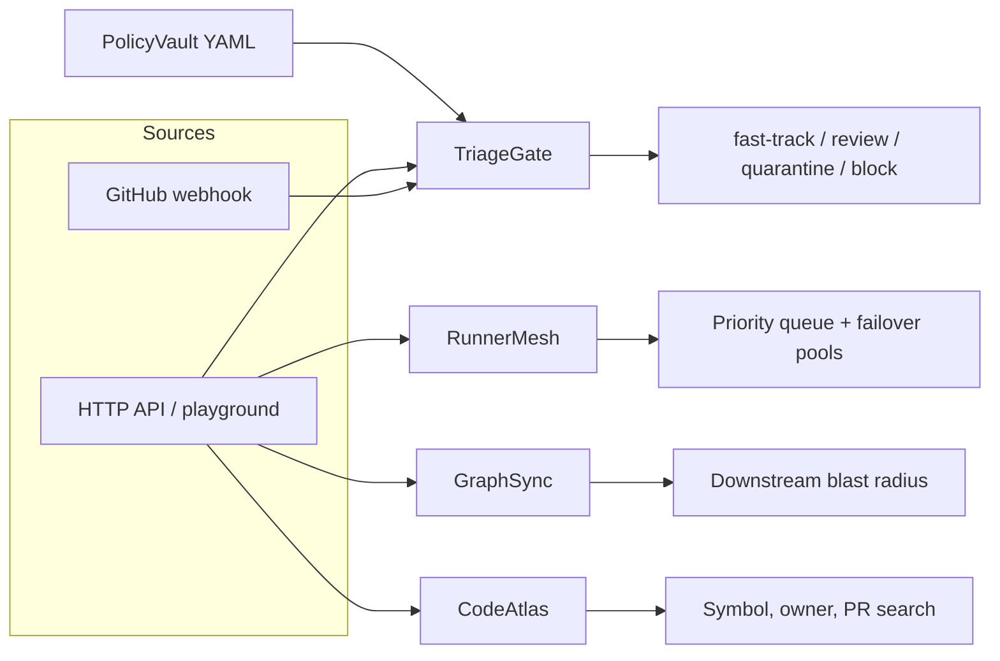

# ForgePulse

**Triage the pull request. Measure the blast radius. Keep the policy off GitHub.**

ForgePulse is a small HTTP service that sits next to GitHub and covers five gaps maintainers feel every week: noisy or AI-generated pull requests, CI queue pain, cross-repo blast radius, code navigation across ownership, and policy locked in GitHub's UI.

> **Status: prototype.** State is in-memory and process-local (or isolate-local on the live Worker). It is not durable, not multi-tenant, and not production. Do not point a real GitHub App at it without a real store, authentication, and a webhook secret.

Live playground (seeded fictional data): [forgepulse.kfairley9999.workers.dev](https://forgepulse.kfairley9999.workers.dev)


## The gap → the module

| GitHub gap | Module | What it does |
| --- | --- | --- |
| AI-generated volume vs. maintainer trust | **TriageGate** | Scores a PR from contributor history, test presence, diff size, title quality, and AI signals. Actions: `fast-track`, `standard-review`, `quarantine-bot-check`, `block-policy`. |
| CI queueing and hosted-runner incidents | **RunnerMesh** | Priority queue with a monotonic sequence (not timestamp-string sort) and automatic failover to a fallback pool when GitHub-hosted runners are marked degraded. |
| Monorepo and multi-repo coordination | **GraphSync** | Breadth-first walk of a repository dependency graph to compute downstream blast radius. Cycles are ignored. |
| Search, ownership, and historical PR context | **CodeAtlas** | Indexes symbols, file paths, code owners, and related PRs, and searches them. |
| Governance locked to GitHub UI settings | **PolicyVault** | Loads portable rules from YAML: protected paths, test thresholds, and whether unverified AI PRs are allowed. |

## Architecture



A native GitHub `pull_request` webhook does not include changed file names. ForgePulse will infer tests when a file list is present (enriched payloads, or a `files` array you attach). When it is not, test presence is flagged **unknown** — the service does not pretend the PR has no tests.

## Quickstart

Python 3.10 or newer. The package is not published to PyPI.

```bash
python -m pip install -e ".[dev]"
python -m forgepulse
```

The playground is at [http://127.0.0.1:8080/](http://127.0.0.1:8080/). Webhooks stay rejected until you set a secret, or (local only) `FORGEPULSE_ALLOW_UNSIGNED=true` with no secret set.

```bash
python -m ruff check src tests
python -m ruff format src tests
python -m mypy --strict src
python -m pytest --cov=forgepulse --cov-fail-under=90
```

Docker:

```bash
docker build -t forgepulse .
docker run --rm -p 8080:8080 -e FORGEPULSE_ALLOW_UNSIGNED=true forgepulse
```

## Curl examples

Trusted contributor with tests:

```bash
curl -sS http://127.0.0.1:8080/triage/pr \
  -H 'content-type: application/json' \
  -d '{
    "repo": "org/payments-core",
    "pr_number": 412,
    "author": "ada",
    "author_merged_prs": 12,
    "title": "Fix settlement rounding for weekend batches",
    "has_tests": true,
    "lines_added": 36,
    "lines_deleted": 9
  }'
```

Blast radius from a shared library:

```bash
curl -sS http://127.0.0.1:8080/graph/impact/org/shared-types
```

Symbol search:

```bash
curl -sS 'http://127.0.0.1:8080/index/search?q=process_settlement'
```

CI failover when hosted runners are degraded:

```bash
curl -sS http://127.0.0.1:8080/ci/enqueue \
  -H 'content-type: application/json' \
  -d '{
    "job_id": "payments-core-ci",
    "repo": "org/payments-core",
    "branch": "fix/weekend-cutoff",
    "priority": 85,
    "preferred_pool": "ephemeral-cloud",
    "github_hosted_healthy": false
  }'
```

Signed webhook (set `FORGEPULSE_WEBHOOK_SECRET` first):

```bash
BODY='{"repository":{"full_name":"org/auth-gateway"},"pull_request":{"number":108,"title":"Add token chain regression tests","user":{"login":"ada"},"files":[{"filename":"pkg/auth/chain_test.go"}]}}'
SIG="sha256=$(printf '%s' "$BODY" | openssl dgst -sha256 -hmac "$FORGEPULSE_WEBHOOK_SECRET" | awk '{print $2}')"
curl -sS http://127.0.0.1:8080/webhooks/github \
  -H 'content-type: application/json' \
  -H 'X-GitHub-Event: pull_request' \
  -H "X-Hub-Signature-256: $SIG" \
  -d "$BODY"
```

## Configuration

| Variable | Default | Meaning |
| --- | --- | --- |
| `FORGEPULSE_WEBHOOK_SECRET` | unset | GitHub webhook secret. When set, a valid `X-Hub-Signature-256` is required. There is no `dev-secret` bypass. |
| `FORGEPULSE_ALLOW_UNSIGNED` | `false` | Honored only when no secret is set. Safe default is fail-closed. |
| `FORGEPULSE_POLICY_PATH` | `policies/default.yaml` | YAML policy file. A packaged copy ships with the module. |
| `FORGEPULSE_HOST` / `FORGEPULSE_PORT` | `127.0.0.1` / `8080` | Bind address for `python -m forgepulse`. |

Default policy (`policies/default.yaml`): require tests above 150 changed lines, protect `infra/`, `auth/`, and `billing/`, and quarantine unverified AI PRs from first-time authors.

## What this is not

- Not a GitHub App yet. The webhook maps a `pull_request` event when file names are supplied; it does not call the GitHub API for files or contributor history.
- Not a CI dispatcher. RunnerMesh records a routing decision. It does not launch runners.
- Not a durable index or graph store. Restarting the process or a Worker isolate clears queue mutations.
- Not published to PyPI.

## Production expansion

1. **TriageGate and PolicyVault.** A GitHub App, policies in version-controlled YAML or Rego, check runs and labels written back to the PR.
2. **RunnerMesh.** A background worker that dispatches to self-hosted pools or a fallback when GitHub Actions is congested or down.
3. **GraphSync.** Parse manifests (`package.json`, `Cargo.toml`, `go.mod`, monorepo graphs) on push and keep blast radius current.
4. **CodeAtlas.** Incremental AST, CODEOWNERS, and PR metadata in a real search store.

## License

MIT. Copyright (c) 2026 Kevin Fairley.
